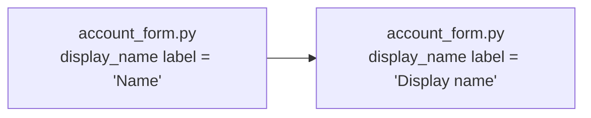

**Recommendation: don't change the structure. Make one edit, the label string in `web/account_form.py`.** This is a copy change, so nothing in it calls for design work.

**What's in `fixture/`:** only `requirements.md`. There's no code yet, so I couldn't open `web/account_form.py` or the label line. Everything below comes from the requirements, not from reading the code.

**The change:**
- The account form shows the `display_name` field's label as `Name`. Change that text to `Display name`.
- The field key, validation, API, persistence and layout stay as they are.
- No new component, module, dependency, data or public contract is needed. The form already has a single owner (`web/account_form.py`), so this is a one-file edit.

**Before → after:**

**Smallest step:**
1. In `web/account_form.py`, change the label text for `display_name` from `"Name"` to `"Display name"`. Change only the text, not the field key.
2. Search for other copies of the old label, such as tests, translation files or snapshots. Update only the ones that are this field's visible label. Leave other "Name" labels alone.

**Check:** render the account form, or run its test, and confirm two things. The `display_name` field shows `Display name`, and the submitted field name is still `display_name`.

**Risk:** low and easy to undo, because it's a text change with no data or contract involved.

I'd skip a second design option, an ADR and an architecture-doc update here, since none of them would add anything for a change this size.