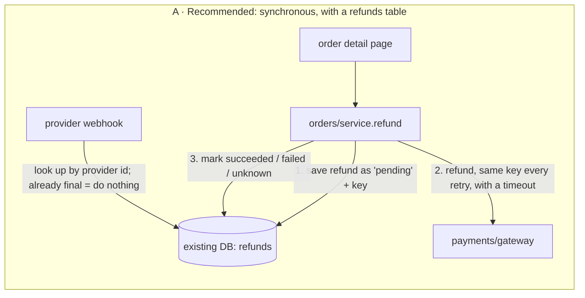
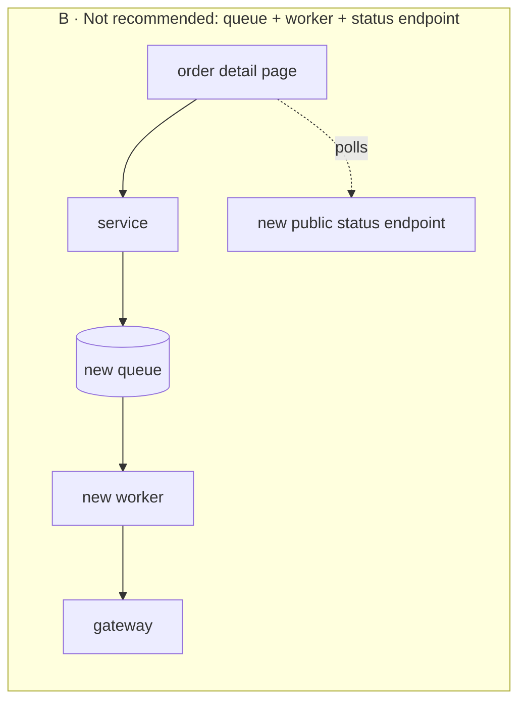

# Operator refunds: design recommendation for `fixture/`

**Verdict:** I can't judge the code yet, because `fixture/` contains only `requirements.md`. My recommendation is to do the refund synchronously inside `orders/service.py` and record each refund in a new table in the existing database. Don't add a queue, a worker or a status endpoint.

## Read this first: the map hasn't been checked against code

`requirements.md` names `orders/service.py`, `web/order_views.py`, `payments/gateway.py` and `db/connection.py`, but none of those files are in `fixture/`. Every statement below about how they behave is **suspected**: I couldn't read or run any of it. The fact that matters most is whether the payment provider accepts an idempotency key, so a repeated refund request is recognised and not paid twice. That needs to be checked in `payments/gateway.py` or the provider's docs before anything is committed.

## Numbers that set the shape

| Input | Value | Status |
|---|---|---|
| Volume | 20 refunds/day | Assumed for launch, not proven |
| Response time | No target | Assumed: the operator can wait a few seconds |
| Provider response time and retries | Not documented | **Unknown, and it drives the timeout design** |
| What "same amount twice" means | Full refunds only, or partial ones too? | **Owner must answer** |

## The two options

- **A** fits every requirement using what the codebase already has. Retries are safe because every attempt sends the provider the same key, which is stored in the database. The operator sees the result when the page reloads, read from the refund's saved status.
- **B** adds a queue and a worker you would have to secure, monitor and back up, plus a public status endpoint that callers would come to depend on. No requirement asks for any of it. B only becomes worth it if the provider regularly takes longer than a page request can wait (roughly over 10s), or if volume grows by orders of magnitude. Neither is shown today.

The thing I'm deliberately **not adding** is a separate store for idempotency keys. The refund row's unique key does that job.

## Which decisions are hard to undo

- **The refunds table (hard to undo).** This is a stored data shape, so changing it later means a migration. Proposed columns: `id`, `order_id`, `amount`, `idempotency_key UNIQUE`, `provider_refund_id UNIQUE NULL`, `status` (`pending|succeeded|failed|unknown`), `attempts`, `last_error`, and timestamps. If the owner confirms full refunds only, add a unique constraint so each order can have at most one refund that isn't `failed`. The database then blocks a second refund even if the application code has a bug.
- **Status on the existing page, not a public API (easy to undo).** This avoids taking on a public refund-status contract now. One can be added later from the same table.
- **Where the code lives (easy to undo).** Put it in `orders/service.py`, which already owns order actions. Don't create a new module until a second refund flow exists.

## The main risk: a timeout after the provider has already refunded

If `gateway` times out, we don't know whether the refund went through. Mark the row `unknown`, never `failed`. A retry must resend the **same** key:
- **If the provider supports idempotency keys,** that's enough.
- **If it doesn't,** the retry must first ask the provider whether a refund with our reference already exists, and only then submit. This is the fact I couldn't check.

## Pre-mortem: a year from now, it failed because…

1. **A double refund after a timeout followed by a retry.** Covered by the stored key, the `unknown` state, and checking the provider before resubmitting.
2. **A webhook arrived before our row was updated, or arrived twice.** The handler looks the refund up by `provider_refund_id` or our reference and moves its status forward only, never back. A duplicate webhook then changes nothing.
3. **Slow provider responses stall the page.** Use a short gateway timeout and show `unknown — retry`. Moving to option B is the planned fallback if timeouts become common.

## A safe first implementation plan (each step can be checked on its own)

1. **Confirm the facts:** read `payments/gateway.py` and the provider docs for idempotency-key support, timeout and retry behaviour, and the webhook payload. Get the owner's answer on partial refunds. *Check:* a short note citing the lines read.
2. **Migration:** create the `refunds` table and its constraints through `db/connection.py`. *Check:* inserting two rows with the same key fails; with full refunds only, a second refund on the same order that isn't `failed` also fails.
3. **Service function `orders/service.refund(order_id, operator, key)`:** it requires the order to be settled, saves the `pending` row, calls the gateway with the key and a timeout, then records the result. *Check:* unit tests with a fake gateway covering success, a hard failure, a timeout (row ends `unknown`), a repeated call (no second gateway call), and a retry after `unknown` (same key sent).
4. **Webhook handler:** status only moves forward, and duplicates are ignored. *Check:* sending the same webhook twice leaves one change and no gateway call. A webhook that arrives before the row is updated still ends in the right state.
5. **Order detail page:** add a refund button whose key is generated when the form is rendered, so a double-click or resubmit reuses it. Show the latest status with a retry action for `failed`/`unknown`. *Check:* an end-to-end test where a double-submit produces one refund.
6. **Release:** put the feature behind a flag and run one real small refund in the provider's sandbox. Hand off to `safe-release` for the migration.

## Questions before you build

1. **Full refunds only, or partial refunds too?** This changes the uniqueness rule on the table.
2. **Is it fine if the operator sometimes sees "outcome unknown — retry" and not an immediate answer?** If it is, option A holds.

Nothing was written or changed. I worked on a single model with no worker dispatch, and spend stayed well under the $2 session cap, which is tighter than your $8.