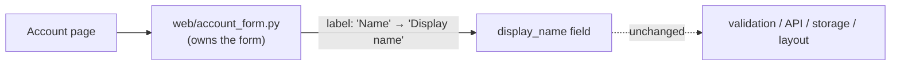

**No new structure is needed. Change one string in the form's one owner.**

**What I found.** `fixture/` holds only `requirements.md`. There's no code yet, and no architecture map or decision records to check against. So this design rests on the requirements doc alone (counted as suspected, since none of it is traced in code). The doc names `web/account_form.py` as the form's one owner, but that file isn't in `fixture/`. Check it exists before starting.

**Structure**

- **Boundary:** `web/account_form.py` owns the label text. Nothing else changes: not the field name `display_name`, the validation, the API, the storage or the layout.
- **Reuse:** the existing form and field. I'm deliberately not adding a label constants module, an i18n layer or a new component. Each would be structure for one string with only one place that sets it.
- **Door:** two-way. It's a visible text change that a one-line revert undoes. No data, API or contract changes.

**Smallest step**
1. In `web/account_form.py`, change the `display_name` field's label from `Name` to `Display name`.
2. If any test or snapshot checks the old label text, update it to match. Leave tests on the field name and validation alone.
3. **Proof:** render the account form and confirm the label reads `Display name`. Also confirm the submitted field key is still `display_name` and the existing form tests pass.

The usual next steps (candidate review, deep dive, a decision record) don't apply here, since nothing about the structure is being decided. This goes straight to implementation.