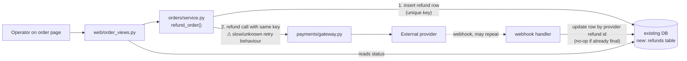

I ran `arch-design` in design mode. **`fixture/` contains only `requirements.md`.** None of the modules it names (`orders/service.py`, `web/order_views.py`, `payments/gateway.py`, `db/connection.py`) are in the folder. So every boundary below is an assumption taken from that document, not something I checked in code. Exploration took one read, well within the budget. I changed no files.

## Recommendation

**Add the refund as one more action in `orders/service.py`, store each refund as a row in the existing database, and call the provider during the operator's request. Don't add a queue, a worker or a public status endpoint.**

The requirements decide this:
- **20 refunds a day and no response-time target.** Nothing here calls for a queue or worker, and none exists to reuse.
- **"Never refund twice," across repeated clicks, repeated webhooks and retries.** That needs a stored record with a uniqueness rule. A unique constraint in the existing database enforces it more simply than anything else.
- **The operator must see the outcome.** The order detail page can read the refund row directly, so no status endpoint is needed.

## Shape

What each module owns:
- **`orders/service.py`**: decides whether a refund is allowed and moves its state. It never knows HTTP or provider details.
- **`payments/gateway.py`**: turns "refund X with key K" into a provider call and returns a clear result: `ok(provider_id)`, `rejected(reason)` or `unknown` (timeout or network error). It never writes to the database.
- **`refunds` table**: the only record of refund state. Columns: `id`, `order_id`, `amount`, `idempotency_key UNIQUE`, `status` (requested → succeeded | failed | unknown), `provider_refund_id UNIQUE NULL`, `error`, `timestamps`. A partial unique index on `order_id` where status isn't `failed` means only one live refund per order, which assumes full refunds only.
- **Webhook handler**: finds the row by `provider_refund_id` and moves it to a final state only if it isn't final already. A repeated webhook therefore changes nothing.

**The rule that prevents double refunds.** A timeout leaves the row as `unknown`, never `failed`, so no blind retry happens. Retrying is allowed only from `failed`, which means the provider said no, or from `unknown` after a provider lookup or webhook confirms nothing went through. Every retry sends the same key.

## Two options

| | A. Synchronous, in the service (recommended) | B. Queue plus worker |
|---|---|---|
| Fits | 20 a day, no latency target, existing owners | High volume or a slow provider |
| New parts | One table | Table, queue, worker, status polling, plus running and monitoring them |
| Risk | Request blocks on a slow provider, softened by a gateway timeout and the `unknown` state | Several more ways to fail, built for load nobody asked for |

Option B would only make sense if the provider turns out to take tens of seconds, and the `unknown` state already covers that case. If the volume assumption changes, A can grow into B: the table and states stay the same and only the caller moves.

## One-way decisions to confirm first

1. **The `refunds` table schema and the idempotency key format.** These are stored data that recovery depends on. I'd derive the key on the server from `order_id` plus an attempt number, never take it from the client.
2. **Whether the provider supports idempotency keys and refund lookup.** This is the biggest unknown, since the requirements say the gateway's retry behaviour isn't documented. If it supports neither, the `unknown` state needs a manual reconciliation step before anyone can retry.
3. **No public refund-state contract.** Keep the status internal to the order page so nothing outside depends on it.

## Pre-mortem: if this has gone wrong a year from now
- **The provider timed out, an operator clicked again, and the customer was refunded twice.** Covered by the `unknown` state, the unique key and the reused provider key.
- **Partial refunds were needed.** The `order_id` uniqueness rule blocks them. I'm accepting that risk for now; changing it later means a migration that swaps the rule for a sum-of-amounts check.
- **A webhook arrived before the row stored the provider id.** The handler should also be able to match on the key or on `order_id`, and log anything it can't match rather than dropping it.

## Implementation plan
Each step ships with nothing visible to operators until step 5.
1. **Migration:** add the `refunds` table and its constraints. It only adds things, so undoing it means dropping the table. Proof: a test that inserting a duplicate key or a second live refund fails.
2. **Gateway:** add `gateway.refund(amount, key)` returning ok, rejected or unknown, with an explicit timeout. Proof: tests against a fake provider for success, rejection and timeout.
3. **Service:** add `refund_order(order_id, operator)` with the state rules. Proof: tests for double click, timeout leading to `unknown`, retry from `failed`, and refusing an order that isn't settled.
4. **Webhook:** add the handler, which does nothing on a final row. Proof: deliver the same event twice and see one change.
5. **View:** add the button and status display on the order detail page behind a flag. Proof: one end-to-end refund against the provider's sandbox.

Then hand off to `build-discipline`.

## Questions for you
- Are refunds always for the full order amount?
- Does the provider accept idempotency keys and support looking up a refund?
- Is there already a webhook endpoint I should extend?

Please also point me at the real code: I'd like to check the four module boundaries before going further.