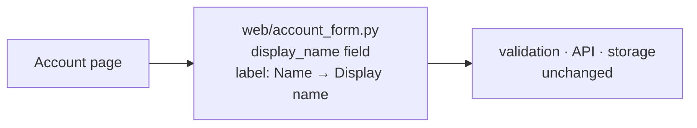

**Verdict:** no architecture work is needed. This is a one-string copy edit in a form that already has a single owner. You don't need a new structure, seam or option.

**What I read:** `fixture/` contains only `fixture/requirements.md`. That file says `web/account_form.py` owns the form, but `web/account_form.py` isn't in the fixture, so I couldn't check where the label is defined. Everything below comes from the requirements, not from the code.

**Structure:** keep it as it is.

**Smallest step:** in `web/account_form.py`, change the visible label of the existing `display_name` field from `"Name"` to `"Display name"`. That one line is the whole change. Leave the field name, validators, API, storage and layout alone.

**Check before editing:** search for the literal `"Name"` near `display_name` (for example `rg -n '"Name"' web/`). If the label shows up in a test, a translation file or a template as well as the form, change only the copies tied to this field. The requirements say there is one owner, so I expect just the one line.

**How to confirm it worked:** load the account page, or run the form's existing test, and check that the label reads `Display name`. The submitted field key should still be `display_name`. If a test asserts the old label, update it in the same commit.

**Is it reversible?** Yes, fully. Copy changes can be undone easily, and no data, public contract or dependency is involved.

**Not recommended:**
- A labels or constants module, an i18n layer, or a configurable label. Nothing in the requirements calls for one.
- An ADR or an architecture-doc update. No architectural decision is being made.