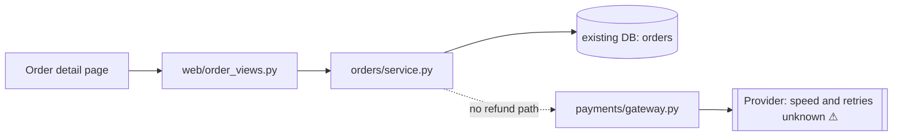
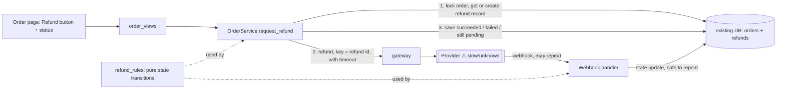

I ran `arch-design` in design mode over `fixture/`, using this session only (no workers, no second model). It used about $0.15 and a few minutes. I changed nothing.

## First: the code described in the requirements isn't in `fixture/`

`fixture/` holds one file, `requirements.md`. The files it describes (`orders/service.py`, `web/order_views.py`, `payments/gateway.py`, `db/connection.py`) are not there. So every boundary below is **suspected**: it comes from the requirements, not from code I read. Nothing permanent (a table schema or a public contract) should be committed until those files are read.

## Verdict

This is a small feature, and the simplest design meets every requirement. Run the refund inside the existing order action, and keep a **refund record in the existing database** that holds an idempotency key: a unique key per refund that makes a repeated request or webhook a no-op. At 20 refunds a day with no response-time target, nothing calls for a queue, a worker or a status endpoint. The real risk is not structure. It's a provider call that times out and gets treated as "failed", then retried into a double refund.

## The two options (compared in this session, not by separate designers)

What decides it, most important first:
1. Never refund twice: repeated clicks, repeated webhooks, retries after a timeout.
2. The operator sees "completed" or "failed".
3. Failures can be retried safely.
4. As few new parts and permanent contracts as possible.

| | **A. Synchronous, refund record in the existing DB (recommended)** | **B. Queue + worker + status endpoint** |
|---|---|---|
| Never refund twice | Yes: unique key plus a state machine | Yes: same key, plus queue redelivery to handle |
| Operator sees result | Shown on the existing order page | Needs a new public status endpoint, which is a permanent contract |
| Retry safety | Retry reuses the same key | Same |
| New parts | One table, one webhook handler | A table, a queue, a worker, an endpoint: more to secure, monitor and back up |
| Breaks down when | The provider is slow (the operator's request waits) | Rarely at 20 a day |

Choosing **A**. B's only advantage is not making the operator's request wait on the provider, and no requirement asks for that. A handles a slow provider by marking the refund `pending` after a timeout and letting the webhook finish it, so B's extra parts are guesswork. If volume or a response-time target changes later, A's refund record is exactly what a worker would read, so moving to B wouldn't need a rewrite.

### Before

### After (A)

## How it works

- **Refund record** (new table in the existing database, owned by `db/connection.py`, so no second datastore): `id`, `order_id`, `amount`, `idempotency_key` (unique), `state` (`pending`, `succeeded`, `failed`), `provider_ref`, timestamps.
  - "Same amount" is guaranteed by a database constraint: only one `pending` or `succeeded` refund per order (for full refunds).
- **States:** `pending` can become `succeeded` or `failed`. `succeeded` is final.
  - **A timeout or unclear provider response stays `pending`, never `failed`.** Only a definite rejection from the provider becomes `failed`.
  - Retrying a `pending` refund reuses the same key. Retrying a `failed` one creates a new attempt.
- **These rules live in one pure function** (`refund_rules`) with no database, network or clock calls. The service and the webhook handler both use it, so the double-refund logic can be tested without I/O.
- **Duplicate webhooks:** the handler finds the refund by key or provider reference and applies the same transition, so a repeat changes nothing. A webhook for an unknown refund is logged and ignored.
- **Operator view:** the refund state is shown on the existing order page. No public status API.

## Permanent decisions (need your sign-off)

- **The refund table and key format.** Data recovery and reconciliation will depend on them. One choice changes the schema: per-refund rows with an `amount` column support partial refunds later, at the cost of a slightly more complex constraint. I recommend per-refund rows.
- **Not adding a status endpoint.** Leaving it out avoids a permanent public contract. It can be added later.
- **Reversible choices I've made myself:** module placement (`orders/refund_rules.py`, the webhook handler next to the order views) and the timeout value.

## Two questions only you or the provider can answer

1. **Does the payment provider accept an idempotency key on refunds,** or let us look a refund up by our own reference? If it does neither, a timed-out request can't be safely retried. We'd have to block retries until the webhook arrives or someone checks manually. This is the biggest unknown, because the requirements say the gateway's retry behavior isn't documented.
2. **Full refunds only, or partial refunds too?** This decides the uniqueness constraint above.

## Safe first implementation plan

Each step keeps existing behavior unchanged and has a check that can fail.

1. **Read the real code.** Open the four files and confirm the boundaries, especially whether `gateway.py` exposes timeouts and idempotency. The plan is revised if they differ.
2. **Add the table only** (purely additive, no code reads it yet). Check: the migration applies, rolls back, and re-applies on a copy of the database. Hand this to `safe-release`.
3. **Write `refund_rules` with no I/O.** Check: unit tests for double-click, duplicate webhook, timeout then webhook, and timeout then retry. The "timeout then retry" test must fail if a timeout is ever marked `failed`.
4. **Add `OrderService.request_refund` against a fake gateway.** Check: two simultaneous requests produce one refund record and one gateway call; a timeout leaves the refund `pending`.
5. **Add the webhook handler.** Check: sending the same webhook twice changes the state once, and the order is marked refunded once.
6. **Add the UI** (button plus status, retry only when allowed), hidden behind an operator-only flag. Check: an end-to-end run against the provider's sandbox covers success, a forced failure and a duplicate webhook.
7. **Launch:** enable the flag for one operator, then check refund records against the provider's report for the first day.

**What could go wrong a year from now**
- **A timeout is treated as a failure and refunded again.** Prevented by the `pending` rule and the test in step 3.
- **A provider retry storm sends many webhooks.** Each one does nothing after the first.
- **Partial refunds are requested.** Per-refund rows make this a constraint change, not a new table.

Which way do you want to go: **A as planned**, or work through the provider-idempotency question first? I'd also need the real `orders/`, `payments/`, `web/` and `db/` code before turning this into a build plan with `build-discipline`.